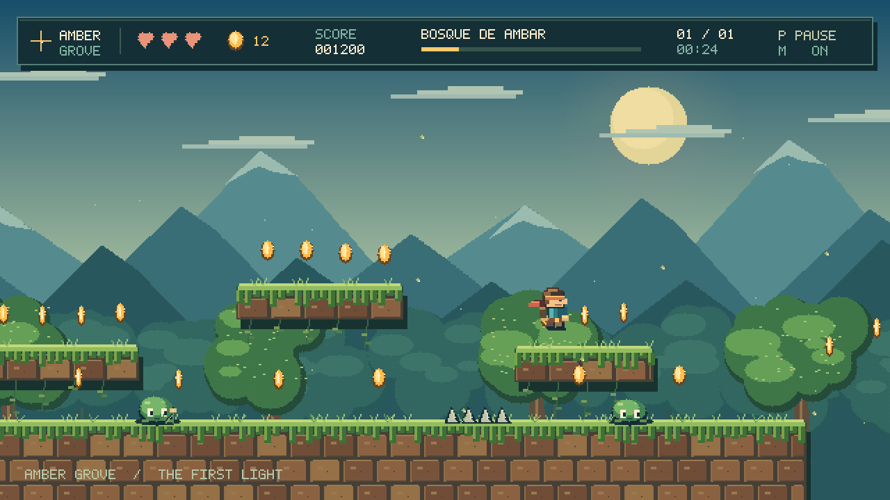

# Amber Grove — Bosque de Âmbar

Um jogo original de plataforma 2D em **C++17**, inspirado no estilo de pixel art da referência enviada por Elias. Atravesse o bosque, colete moedas, derrote as criaturas e alcance o portal de âmbar.



**Versão 1.0.1: uma fase completa.** Não exige Python, SFML, internet ou arquivos de imagem para jogar. Personagem, cenários, fonte e efeitos sonoros são produzidos pelo próprio programa. A jogabilidade usa teclado no Windows.

Esta revisão troca o desenho direto na janela por um quadro preparado fora da tela, para corrigir a causa provável da piscada preta observada no vídeo de execução no Windows. A confirmação visual dessa correção no Windows ainda está pendente.

## Jogar no Windows

1. Baixe o projeto em **Code → Download ZIP** e extraia **todo o ZIP**, ou clone o repositório:

   ```powershell
   git clone https://github.com/eliasramineli-sys/AmberGrove.git
   cd AmberGrove
   ```

2. Abra **AmberGrove.exe** ou **JOGAR.bat**.
3. Pressione **Enter** para iniciar.

O executável incluído é de **64 bits**, compilado para Windows com as bibliotecas padrão de sistema. Ele foi gerado por compilação cruzada; a abertura da janela, o teclado e o áudio ainda precisam ser conferidos em um computador Windows. As regras do jogo e a renderização foram executadas e verificadas em Linux.

| Tecla | Ação |
|---|---|
| A / D ou setas esquerda / direita | Mover |
| Espaço / W / seta para cima | Pular |
| J / Z | Atacar com espada |
| P / Esc | Pausar e continuar |
| R | Reiniciar a fase |
| M | Ativar/desativar efeitos sonoros |
| F11 | Alternar tela cheia |
| Enter | Iniciar / jogar novamente após o resultado |
| Alt + F4 | Fechar |

**Objetivo:** chegue ao portal à direita. A fase tem três vidas, duas bandeiras de checkpoint e rotas pelo chão e por plataformas. Pular sobre inimigos também os derrota. Uma moeda vale 100 pontos; um inimigo, 250; um checkpoint, 500. A vitória adiciona 500 pontos por vida restante.

O recorde e a preferência de áudio ficam em `%LOCALAPPDATA%\AmberGrove\record.txt`. A fase em andamento não é salva. O jogo pausa quando perde o foco da janela.

## O que está implementado

- Fase com 4.200 unidades de largura, rolagem de câmera e portal de chegada.
- Movimento com aceleração, gravidade, colisões com chão, laterais e teto.
- Tolerância curta para pular após sair de uma borda e memória de um pulo pressionado pouco antes de aterrissar.
- Personagem com animações de corrida, lenço, espada e piscar de invulnerabilidade.
- Inimigos em patrulha, golpes de espada, salto sobre inimigos, dano e retorno ao checkpoint.
- Moedas animadas, partículas de impacto, vaga-lumes e tremor de câmera.
- Montanhas e árvores com paralaxe, céu em gradiente e cachoeira animada.
- Telas de abertura, pausa, fim de jogo e vitória; HUD com vidas, tempo e progresso.
- Efeitos sonoros sintetizados; sem trilha musical nesta versão.
- Recorde local, escala inteira de pixels e barras para preservar a proporção em diferentes janelas.

## Recompilar no seu Windows — MSYS2 UCRT64 / VS Code

Requer **GCC com C++17**, como o instalado em `C:\msys64\ucrt64\bin\g++.exe`. O VS Code serve como editor; quem compila é o GCC.

No PowerShell, dentro da pasta do projeto:

```powershell
powershell -NoProfile -ExecutionPolicy Bypass -File .\build.ps1
.\AmberGrove.exe
```

Ou dê dois cliques em **COMPILAR.bat**. O script procura o compilador no PATH e na instalação padrão do MSYS2. Não baixa pacotes.

Para compilar e rodar os testes:

```powershell
powershell -NoProfile -ExecutionPolicy Bypass -File .\build.ps1 -Test
```

Se o GCC ainda não estiver instalado, abra o terminal **MSYS2 UCRT64** e execute:

```sh
pacman -S --needed mingw-w64-ucrt-x86_64-gcc
```

Se você usa uma instalação do MSYS2 fora de `C:\msys64`, adicione a pasta `ucrt64\bin` correspondente ao PATH antes de compilar.

## Alternativa: CMake / Visual Studio

Instale CMake 3.20+ e o componente **Desenvolvimento para desktop com C++** do Visual Studio. Abra a pasta no Visual Studio ou execute:

```powershell
cmake -S . -B build
cmake --build build --config Release
ctest --test-dir build -C Release --output-on-failure
.\build\Release\AmberGrove.exe
```

O último caminho corresponde ao gerador Visual Studio. Com gerador de configuração única, o executável fica diretamente em `build`.

## Organização do código

| Arquivo | Responsabilidade |
|---|---|
| `src/game.hpp` | Estado do jogo e interfaces de desenho |
| `src/game.cpp` | Fase, física, colisões, inimigos, itens e regras |
| `src/render.cpp` | Pixel art, animações, interface e renderizador |
| `src/platform_windows.cpp` | Janela nativa, teclado, áudio e recorde |
| `src/main.cpp` | Entrada do aplicativo e modo de captura |
| `tests/tests.cpp` | Testes das regras e travessia automatizada completa |
| `docs/VALIDACAO.md` | Verificações executadas e limites conhecidos |

Para editar o mapa, altere as listas `solids`, `spikes`, `enemies` e `checkpoints` em `Game::reset()`. O início está à esquerda e o portal em x=4082. As medidas usam a resolução lógica de 640 × 360 pixels. Para ajustar o salto ou a velocidade, veja `Game::update()`.

## Por que não exige SFML?

A referência mostra includes de SFML, mas um jogo desse estilo também pode ser desenvolvido com um renderizador próprio. Esta versão usa um framebuffer em C++ e a API nativa do Windows para exibir os pixels. Isso elimina dependências externas e problemas de compatibilidade entre SFML e compiladores.

O resultado é uma interpretação original do estilo, com uma fase curta. Não é uma reprodução exata da ilustração: o acabamento visual depende da direção de arte, das animações e do desenho dos cenários, além da linguagem escolhida. Um projeto maior pode adotar sprites desenhados por artista, editor de mapas e SFML/SDL sem substituir as regras centrais.

## Verificação em Linux e captura sem janela

O modo gráfico interativo é específico para Windows. Em Linux, o núcleo e o renderizador podem ser testados sem ambiente gráfico:

```sh
g++ -std=c++17 -O2 -Wall -Wextra -Wpedantic -Isrc tests/tests.cpp src/game.cpp src/render.cpp -o amber_tests
./amber_tests
g++ -std=c++17 -O2 src/main.cpp src/game.cpp src/render.cpp -o amber_preview
./amber_preview --screenshot frame.ppm play
```

As opções de captura são `title`, `play` e `end`. Elas montam cenas representativas com o mesmo renderizador do jogo; a cena de captura não equivale a uma partida registrada. PPM é um formato simples de imagem; as prévias PNG incluídas foram convertidas desses quadros, sem alteração da arte.

## Estado e limites

- Uma fase para um jogador; sem controle de videogame, multiplayer, editor de mapas ou versão móvel.
- Sem SDK gráfico externo, shaders de GPU ou instalação de recursos adicionais.
- Compilação cruzada do executável e testes locais concluídos; interação da janela e reprodução de áudio no Windows pendentes de validação nesse sistema.
- O workflow de GitHub Actions compila e executa os testes em Linux e Windows a cada push ou pull request. Os resultados ficam na aba Actions do repositório.
- A licença de distribuição do projeto fica a definir pelo autor. Nenhum sprite, áudio ou personagem comercial foi copiado da referência.

Referências técnicas: [StretchDIBits, Microsoft](https://learn.microsoft.com/en-us/windows/win32/api/wingdi/nf-wingdi-stretchdibits), [mensagens de teclado, Microsoft](https://learn.microsoft.com/en-us/windows/win32/inputdev/keyboard-input) e [PlaySound, Microsoft](https://learn.microsoft.com/en-us/windows/win32/multimedia/the-playsound-function).
